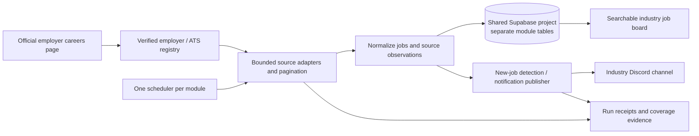

# Job scrapers architecture — verified November 10, 2026

This documents the deployed system, not the earlier plan for an automated resume-writing platform. Updated after the November 10 evening reliability repair. Live configuration, deployed source and run receipts take precedence over historical prose. Inspect [scrapers.json](scrapers.json) and run [verify_scrapers.py](verify_scrapers.py) when resuming work.

## System boundary

The shared database project is `alxgteasytezekyunyjk`. This identifier is not a credential. Industry separation is by tables and publication destinations. The scraper discovers and refreshes jobs; it does not submit applications. The private Markdown application ledger and personal skills matrix are separate from this public system. An applied checkbox is not an application receipt.

## Deployment and schedule inventory

| Module | Source repository / branch | Production runtime | Configured schedule | Deadline |
|---|---|---|---|---|
| Robotics | `misterplusev/job-radar`, `master` | GitHub Actions execution; Cloudflare Durable Object alarm dispatch | Hourly at :09 UTC; no GitHub cron | 45 minutes |
| Tech | `misterplusev/job-radar-tech`, `master` | GitHub Actions execution; Cloudflare Durable Object alarm dispatch | Hourly at :37 UTC; no GitHub cron | 30 minutes |
| Sports teams | `sports_teams/` inside `misterplusev/job-radar`, `master` | GitHub Actions execution; Cloudflare Durable Object alarm dispatch | Hourly at :23 UTC; no GitHub cron | 45 minutes |
| Sportsbook | `misterplusev/sportsbook-jobs-dashboard`, **`prod/sportsbook-jobs`** | Private Hugging Face Space `abetco/sportsbook-jobs`, branch `main` | 06, 08, 10, 12, 14, 16, 18, 20 in `America/New_York`, **every day** | Scrape subprocess: 45 minutes |

Hourly minutes remain :09/:23/:37 in Pacific and Arizona time. Sportsbook's Pacific slots are 03, 05, 07, 09, 11, 13, 15, 17. Arizona does not observe DST: its sportsbook slots are 04–18 by twos during Eastern standard time and 03–17 by twos during Eastern daylight time.

GitHub workflows serialize runs with concurrency groups. Public robotics/tech repositories do not make execution timing guaranteed. GitHub documents that scheduled events can be delayed or dropped and execute from the default branch. See [GitHub's schedule documentation](https://docs.github.com/en/actions/reference/workflows-and-actions/events-that-trigger-workflows#schedule).

**Historical observation before the evening repair, November 10:** robotics scheduled starts included 01:27, 09:40 and 17:43 UTC; tech 02:53 and 11:40 UTC; teams 04:39 and 13:32 UTC. Recent gaps reached about 7–11 hours. The later teams repair runs were manual. These are not proof of working hourly delivery; the cause is unconfirmed. Sportsbook's 12:00 Eastern slot completed at about 12:04, with the next slot at 14:00 and live health healthy.

Sportsbook's old `scrape.yml` is `disabled_manually`. Its current default-branch file contains only `workflow_dispatch`; older checkouts still contain an hourly cron. Neither is the live schedule. Cloudflare worker `abet-jobs-watchdog` has `0 */2 * * *` UTC monitoring cadence in versioned configuration; deployed control-plane inspection is currently unavailable with the operator token. That is watchdog configuration, not the scraper schedule. Sports-team Windows tasks are disabled, and the sports-team Hugging Face/Cloudflare experiment is retired. Do not create a second scheduler alongside production.

## Source and code map

| Module | Local operator directory | Source configuration | Ingest / provider contract |
|---|---|---|---|
| Robotics | `D:\abet\job-radar` | `config/targets.json` | `run.py ingest`; `jobradar/providers/`, provider `fetch(run_id) -> list[Job]` |
| Tech | `D:\abet\job-radar-tech` | `config/targets.json` | Same interface, independent configuration and namespace |
| Sportsbook | `D:\abet\sportsbook-jobs-runtime` | `scripts/providers/__init__.py` auto-discovers provider classes | `scripts/scrape.py`; classes ending in `Provider`, with `company` and `scrape() -> list[Job]` |
| Sports teams | `D:\abet_ops\sports_teams` | `official_careers_registry.json` and `sources.json` | `pipeline_local.py --cloud`, `live_refresh.py`, `providers/`; publisher is separate |

The local sportsbook checkout was on historical `fix/oct05-runtime` with uncommitted changes at verification. GitHub's default `main` contains the dashboard and legacy scraper material. **Neither substitutes for `prod/sportsbook-jobs` or deployed Space source.** Preserve local work; inspect source control without resetting the checkout.

Robotics/tech providers include Greenhouse, Lever, Ashby, Amazon and Workday. The evening repair makes HTTP/pagination failures explicit, removes Amazon's silent five-page truncation, retains Workday's first-page total, and runs each provider in a killable subprocess. A manifest records completeness, elapsed time, persistence, cleanup and confirmed delivery. Target entries can be a slug or an object with slug/options. Employer careers links establish which ATS endpoint belongs to the employer; an ATS is a legitimate official source when the organization points to it. Do not infer a career board from an old job URL or treat a general job aggregator as official evidence.

Sports teams explicitly enumerates 124 NFL/NBA/MLB/NHL organizations (32/30/30/32). TeamworkOnline is queried through the exact employer boards and real pagination. Broad league discovery is not used to add production sources. Other adapters include Workday, Greenhouse, ADP, UKG, NBA and team-specific sites. See the module README and registry for the complete current list. Shared ownership sources retain their real parent employer names.

Two separate proofs matter: (1) the source currently returns a valid complete observation, and (2) the actual team's official careers page points to that source. As of November 11, all 124 have a working source and recorded official career-route linkage. The final Bulls, Clippers and Bucks evidence was established through rendered official-page links and exact configured-employer matching; see the complete verification report and screenshot gallery. Four blocked TeamWork routes now use verified employer-selected ATS endpoints; the Astros dead route is retained as retired with its official UKG replacement. All 152 active source checks passed in the November 11 cutover. League-linked paths are labeled explicitly in registry evidence. See [live coverage](https://misterplusev.github.io/job-radar/coverage.html); it can change after this snapshot.

## Persistence and state

| Module | Jobs | Runs | Applications | Extra state |
|---|---|---|---|---|
| Robotics | `robotics_jobs` | `robotics_job_scrape_runs` | `robotics_applications` | `robotics_jobs_with_applied` view; `robotics_job_notifications` durable queue |
| Tech | `tech_jobs` | `tech_job_scrape_runs` | `tech_applications` | `tech_jobs_with_applied` view; `tech_job_notifications` durable queue |
| Sportsbook | `jobs` | `job_scrape_runs` | `applications` | `jobs_with_applied` view |
| Sports teams | `team_jobs` | `team_job_scrape_runs` | `team_applications` | `team_job_observations`, `team_job_notifications`, URL aliases and repair backup |

Robotics/tech schema application runs through `db/apply_schema.py`; inspect the module-specific SQL and migrations. Sportsbook migrations live under `scripts/` and `db/` as applicable to the production branch. Teams uses its `db/` migration files. Re-read the exact file before executing a migration. A local SQL file can lag the deployed database.

Normalize company, title, canonical application URL, location, raw/clean descriptions, ATS/source, source identifier, remote/salary information when supplied, employer posting date, observation time and run ID. Canonical URL and employer identity provide deduplication; retain URL aliases across migrations. Upsert updates existing rows. PostgREST `Prefer: resolution=merge-duplicates` means insert **or update**, not `ON CONFLICT DO NOTHING`; see [PostgREST upsert](https://docs.postgrest.org/en/stable/references/api/tables_views.html#upsert).

Keep `posted_at` (employer evidence), `first_seen` (our discovery) and `last_seen` (latest successful observation) distinct. Robotics/tech's model includes `posted_at`, `scraped_at`, `is_active` and source payload. Legacy sportsbook code supplies a discovery-time `posted_at` fallback only for new jobs lacking an employer date. Do not interpret that fallback as an employer claim. Teams preserves immutable discovery history and does not replace employer dates with alert time.

A failed source is not an empty source. Teams records per-source completeness and only retires missing listings from verified complete observations; shared-source jobs are protected. Details refresh in bounded batches (250 pages and a 15-minute detail budget). A blocked detail page preserves its prior description. Robotics/tech now suppress cleanup on any partial provider run, bound encoded cleanup requests below 6 KB, and count confirmed updates. Verified empty sources are reconciled by stored source identity. Sportsbook retains its older company-level reconciliation behavior.

## Discord delivery and intentional differences

| Module | What becomes eligible | Sending behavior at verification | Durable retry after process ends? |
|---|---|---|---|
| Robotics | Newly discovered URL; existing date/relevance gates retained | Five embeds, 2.1-second pacing, eight rate-limit attempts | Yes: persistent pending intent, confirmed message IDs and chunk acknowledgements |
| Tech | Newly discovered URL; existing date gate retained | Five embeds, 2.1-second pacing, eight rate-limit attempts | Yes: same durable delivery contract as robotics |
| Sportsbook | Newly discovered URL, recency filter (14 days) | Five embeds; 0.5-second pacing; three request attempts | Same limitation |
| Sports teams | New URL queued; active/source/date eligibility checked | Five embeds; 2.1-second pacing, bounded retry and 10-minute delivery budget; `--limit 0` | Yes: pending/delivered state, each successful chunk acknowledged |

Sportsbook still has a persistence-before-notification loss risk. Robotics/tech now enqueue intent before job upsert, verify that a queued job was successfully stored and remains active, and acknowledge only confirmed chunks. New modules must have a durable queue and tests at this failure boundary. Exact-once delivery is not guaranteed even with a queue: Discord acceptance followed by lost acknowledgement can require reconciliation.

There is **no 20-job cap** in teams production. `--limit 0` means all eligible pending jobs, within the bounded delivery run. Unsent jobs remain queued. The November 10 recovery delivered 506 previously missed individual alerts; the next normal run delivered two new jobs. Do not routinely enable recovery or clear delivery history to make more posts appear.

Robotics/tech production workflows run ingestion and dashboard rendering. Their optional skills scoring, LLM judging and document generation commands are **not** scheduled by these workflows. Do not describe production notifications as a personalized scored-match digest or assume jobs were applied to automatically.

## Frontends and health

| Module | Board | Hosting / evidence |
|---|---|---|
| Robotics | [robotics-jobradar-board](https://misterplusev.github.io/robotics-jobradar-board/) | Separate `misterplusev/robotics-jobradar-board`, `main`, static `index.html` / `browse_all.html`; ingestion also uploads a rendered HTML artifact |
| Tech | [jobradar-tech-board](https://misterplusev.github.io/jobradar-tech-board/) | Separate `misterplusev/jobradar-tech-board`, `main`, static frontend; ingestion also uploads an HTML artifact |
| Sportsbook | [sportsbook dashboard](https://sportsbook-jobs-dashboard.vercel.app) | Next.js/Vercel, source repository's frontend; [sanitized watchdog health](https://abet-jobs-watchdog.abetco.workers.dev/jobs-health) |
| Sports teams | [team board](https://misterplusev.github.io/job-radar/) | Workflow deploys Pages from `sports_teams/out`; [health](https://misterplusev.github.io/job-radar/health.json), [coverage JSON](https://misterplusev.github.io/job-radar/coverage.json) |

A rendered artifact is not proof the separately hosted robotics/tech board was redeployed. These frontends and the database have separate freshness checks. Teams publishes its board, run manifest and coverage together. Its workflow can expose degraded health while successfully persisting jobs and delivering alerts; inspect provider receipts instead of using one green/red icon as the whole diagnosis.

## Secrets, provenance and known limits

Use names, never values, in documentation. GitHub stores `SUPABASE_URL`, `SUPABASE_SERVICE_ROLE_KEY`, migration credentials `SUPABASE_ACCESS_TOKEN` / `SUPABASE_PROJECT_REF` where used, and `DISCORD_WEBHOOK_JOBS` for robotics/tech or `DISCORD_WEBHOOK_TEAMS` for teams. Identically named secrets are scoped to different repositories. Sportsbook uses Space runtime secrets, including its own database/webhook credentials and authenticated trigger token; the watchdog has its own secret store. Public boards must never receive service-role keys. Owner-scoped application RLS must not be replaced with legacy anonymous write policies.

Private Space source revision checked: `95db2a29832416e9fc86df276b5e7fce7de88314`. Its launcher and GitHub production launcher have identical text after CRLF/LF normalization (SHA-256 `ce8df4978837c5734ba7f0116e519144a2fc972aed2cf1628ce23f6a245bc28f`). Raw bytes differ by line endings. Scraper SHA-256: `72a43e62f4ce209efb41fac9e555f8fb9c0dc8c26b05592540a4ec0c38524fdb`. Runtime bundle manifest schema is `abet.jobs.hf-bundle.v1`; the manifest checked contains 36 files. Future deployment checks must compare source, manifest and deployed revision again.

The robotics/tech/sports-teams GitHub scheduling dependency was replaced by the Cloudflare alarm scheduler. Its public health is https://abet-jobs-scheduler.abetscrape.workers.dev/health and its code is `job-radar/runtime/cloudflare/worker.mjs`. It serializes slot dispatch, checks existing run titles, and detects stale executions. GitHub Actions remains the execution host. No extra paid tier or local process was introduced.

Current verification: all 124 official team career routes are evidenced and all 152 configured source routes passed. All eight standalone/dashboard views were exercised in a real browser on November 11; see the complete verification report. Remaining limits: sportsbook lacks durable notification recovery equivalent to the other modules; deployed watchdog-source parity is unverified; optional job descriptions may be unavailable. The read-only runtime checker alone does not test every frontend control or future employer changes.

## Exhaustive source and dashboard expansion

The [itemized source inventory](inventory/README.md) records paths, revisions, line counts, script definitions and workflow metadata. The [live schema dictionary](inventory/DATABASE.md) supersedes assumptions from local SQL files; notably robotics/tech currently lack `first_seen_at`. [Dashboard wiring and all eight URLs](2026-11-10%201145%20Dashboard%20Jobs%20Wiring%20and%20Inventory%20Guide.md) document the three modules added to the existing sportsbook dashboard.
