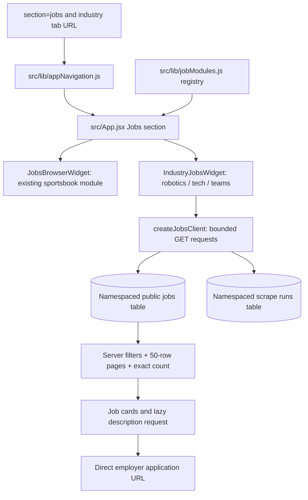

# Jobs documentation and dashboard wiring — November 10, 2026

## Open the actual modules

| Industry | Independent standalone page | ABET dashboard module | Live table |
|---|---|---|---|
| Sportsbook | [Standalone](https://sportsbook-jobs-dashboard.vercel.app/) | [Sportsbook Jobs](https://abet-dashboard.vercel.app/?section=jobs&tab=jobs-browser) | `public.jobs` |
| Robotics | [Standalone](https://misterplusev.github.io/robotics-jobradar-board/) | [Robotics Jobs](https://abet-dashboard.vercel.app/?section=jobs&tab=robotics-jobs) | `public.robotics_jobs` |
| Tech | [Standalone](https://misterplusev.github.io/jobradar-tech-board/) | [Tech Jobs](https://abet-dashboard.vercel.app/?section=jobs&tab=tech-jobs) | `public.tech_jobs` |
| Sports teams | [Standalone](https://misterplusev.github.io/job-radar/) | [Sports Team Jobs](https://abet-dashboard.vercel.app/?section=jobs&tab=teams-jobs) | `public.team_jobs` |

All four standalone pages returned HTTP 200 during this audit. The dashboard formerly exposed only sportsbook jobs; the November 10 change adds robotics, tech and sports teams to its Jobs section. Each new tab queries the corresponding live Supabase table. It does not use an iframe or copy the obsolete local `public/data/team_jobs.json` into the app.

## Exhaustive inventory within a defined system boundary

- [All inventoried files, source revisions, physical line counts and script definitions](inventory/README.md).
- [Machine-readable file/symbol/import inventory](inventory/source_inventory.json): repository path, local path when known, revision, blob/SHA-256 hashes, bytes, category, physical/nonblank lines, Python definition ranges, JavaScript declaration lines, SQL object locations, and workflow step/cron metadata.
- [Live database dictionary](inventory/DATABASE.md): every job-related table/view, column, default, constraint, index, grant, RLS policy, view definition, trigger and trigger function found in the catalog export.
- [PostgreSQL catalog JSON](inventory/database_catalog.json) and [local SQLite metadata](inventory/sqlite_catalog.json).
- [Architecture](2026-11-10%201030%20Job%20Scrapers%20Architecture.md), [operations](2026-11-10%201030%20Job%20Scrapers%20Operations%20Runbook.md) and [new-industry build specification](2026-11-10%201030%20New%20Industry%20Scraper%20Build%20Guide.md).

The scope includes all tracked files in the scraper source snapshots, sportsbook frontend branch, both separate static board repositories, the ABET dashboard repository, the deployed sportsbook Space, and the local sports-team operator scripts. The dashboard repository contains unrelated sports/odds code; it is inventoried for completeness, while the dependency trace below identifies the jobs path specifically.

Physical lines include comments and blank lines; nonblank lines are also provided. These are not claimed to be semantic statement counts. Python definitions use AST start/end ranges. JavaScript definitions use a text scan, explicitly labeled, and are not a complete dynamic call graph. Generated job datasets, binaries, secrets and private applicant materials receive metadata-only treatment, with no copied content. This is an exhaustive inventory of the declared snapshots, not a claim to know every abandoned file on every drive.

The Cloudflare watchdog's versioned source/configuration is included under the sportsbook runtime. Its deployed script/settings return HTTP 404 with the available token; public health is accessible. The inventory explicitly marks that deployed-source verification gap rather than claiming a match. Its two-hour monitoring cron is verified in repository configuration, not newly certified in Cloudflare's control plane.

## Dashboard source, state and data flow

Repository: private `misterplusev/abet-mlb-monitor-widgets`; default/deployment branch `main`. Operator checkout: `D:\abet_ops\abet-dashboard`. Production project: `abet-dashboard`, Vercel project ID `prj_akr4Q0Dq7t8Pnuf6JpkO5BAZry8z`. Public primary URL: `https://abet-dashboard.vercel.app/`. Runtime implementation commit: `026aece41b5f745708596cce95f4ea25220f5b3c`.

| File relative to dashboard root | Responsibility |
|---|---|
| `src/App.jsx` | Jobs section, four tabs, original sportsbook widget, three new industry widget mounts |
| `src/components/HomePage.jsx` | Jobs landing navigation and four-industry description |
| `src/lib/appNavigation.js` | URL persistence, back/forward navigation; old `teamsjobs` bookmark maps to Jobs/teams |
| `src/lib/jobModules.js` | Module/table/run-table/URL registry, schema-aware selects, server pagination, filters, abort/deadline handling, HTTP failures, safe employer URLs |
| `src/widgets/IndustryJobsWidget.jsx` | Search/location/company/league controls, 50-row pages, clear errors/empty states, descriptions, observed dates and run metadata |
| `src/widgets/IndustryJobsWidget.css` | Responsive jobs layout, controls, status, results and descriptions |
| `src/widgets/JobsBrowserWidget.jsx` | Existing sportsbook experience, original app tracking and runtime-health presentation |
| `src/widgets/JobsBrowserWidget.css` | Existing sportsbook styles |
| `src/lib/jobsRuntimeStatus.js` | Sportsbook schedule/manifest presentation helpers |
| `src/lib/bookLogoRegistry.js` | Sportsbook logo resolution |
| `src/auth/` and `src/lib/supabase.js` | Existing authentication and app-core client; jobs browser GETs use public access only |
| `tests/job_modules.test.mjs` | Route resolution, real-schema selects, quoted filters, paging totals, error/cancellation handling and unsafe-link rejection |
| `scripts/verify-job-modules-live.mjs` | Bounded GET-only proof of all four live tables, distinct page boundaries, filtering, description and run reads |
| `package.json`, `vite.config.js`, `vercel.json`, `scripts/20260928_130000_vercel_build_router_v1_0_0.mjs` | Build/test contracts, assets, output, and Vercel build routing |

Every path above has exact line and revision information in the [dashboard file inventory](inventory/abet-dashboard.md).

Public data comes from `https://alxgteasytezekyunyjk.supabase.co/rest/v1/`, using `VITE_APP_CORE_SUPABASE_URL` and `VITE_APP_CORE_SUPABASE_ANON_KEY` (legacy fallback names: `VITE_SUPABASE_URL`, `VITE_SUPABASE_ANON_KEY`). Never supply a service-role key to these frontend variables. Server filters use escaped values and deterministic `posted_at DESC NULLS LAST, id DESC` ordering. Description requests happen only when expanded. Requests abort on unmount/filter changes and have a 20-second deadline. Metadata failure does not erase usable job results; data failure produces an error, not a false empty board.

Robotics and tech have no `first_seen_at` column in the inspected live schema. Teams has `league`, `team`, `salary` and `first_seen_at`; those are selected only for teams. Source-run timestamps are `created_at` for robotics/tech/teams and `started_at` for sportsbook. A loaded-at timestamp is not a posting date or proof that all sources succeeded. The latest source result is labeled as one source result, not whole-pipeline health.

The new modules are read-only job browsers. They do not submit applications or synchronize the private Markdown application ledger. The existing sportsbook application controls remain their own feature. User receipt/rejection history must still be checked in the master ledger when choosing jobs to apply to.

## Deployment and evidence

The full existing dashboard build and regression gates passed, including seven new jobs-module tests. Live GET verification checked all four tables, two distinct pages, location filtering, descriptions and source-run metadata. Initial active counts were sportsbook 860, robotics 20,697, tech 3,737 and teams 2,092; these are observations, not fixed expected counts.

Vercel blocked the first automatic Git deployment because the local Git author `abet-hq` lacks team deployment permission. The authenticated GitHub account is `misterplusev`. Use legitimate authenticated project/repository operations; do not change project membership or weaken protection. A blocked deployment cannot be redeployed directly; Vercel requests a fresh commit. The documentation commit made through the authenticated repository owner triggered the successful production build: `b8bb117b88107ce919d95496ce60c1cfd8f0f126`, deployment `dpl_GMh1ojskpc1pL8MP1WapNFKzoGer`, READY and assigned to `abet-dashboard.vercel.app`.

[Production HTTP, bundle, data and CORS evidence](audit_20261110/public_pages_verified.json) confirms all four dashboard URLs and all four standalone pages. [Live client proof](audit_20261110/dashboard_live_data.json) records pagination, filtering, descriptions and source-run reads. The sportsbook active count changed from 860 during the initial test to 856 during the production check; ongoing refresh is expected, and no fixed count is asserted as permanent.

Browser automation was not started: the operator's machine-wide stop switch remains set. Verification here covers source, tests/build, public HTTP, and live data behavior; it is not a visual browser screenshot proof. This limitation must stay explicit until the operator's browser restriction permits a visual pass.

## Refreshing this documentation

`generate_inventory.py` reads pinned Git objects from the explicit checkouts and GETs the two standalone board repositories. It never imports providers. `inventory_runtimes.py` adds the deployed Space inventory and watchdog inspection result without recording credential values. `export_job_schema.sql` is a read-only PostgreSQL catalog query; `build_schema_dictionary.py` converts its saved artifact and local SQLite metadata into the dictionary. `verify_scrapers.py` checks scheduler declarations and recent execution evidence; `scripts/verify-job-modules-live.mjs` checks dashboard data behavior.

Read the scripts before running, update source refs intentionally, and preserve uncommitted work. Regenerate after runtime/schema/navigation changes, then check links, hashes, secret exclusions and the affected module's live behavior. Record source/deployment drift explicitly. Do not run historical `wire_dashboard.py` or `verify_jobs_expansion.py` as production proof: they reference obsolete paths and may have unrelated runtime side effects.
