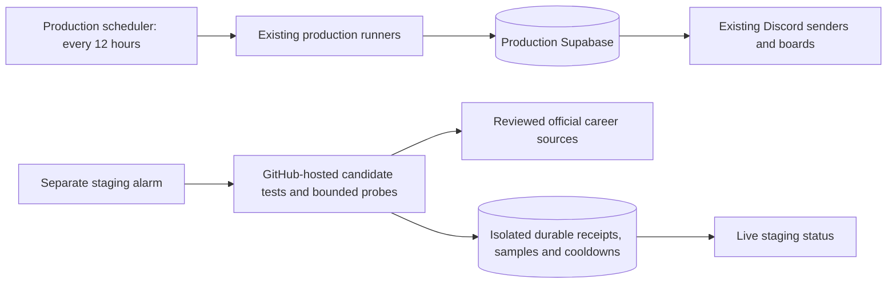

# ABET jobs: recurring isolated cloud staging

Status: deployed and recurring operation verified; live scraper repair acceptance remains incomplete. This document describes the staging environment built November 17, 2026 UTC. See the adjacent build handoff for the latest execution checkpoint and acceptance evidence for observed results. It does not declare the proposed Workday repair successful.

## Purpose and boundary

Production continues collecting and announcing jobs every twelve hours. Staging repeatedly runs the pinned development code's regression tests and a small rotating sample of real employer sources. This permits measurement of retry behavior without giving development code production database keys or Discord webhooks. No candidate is automatically promoted.

Staging is a bounded validation environment, not another full scrape of every employer every hour. Its database contains run receipts, source observations, cooldowns and small job samples. It does not clone the production Supabase schema or hold the complete jobs history. Persistence and notification behavior are exercised by the existing module tests with isolated cloud fixtures and mocked services. Full isolated PostgreSQL integration, all-source coverage and actual Discord delivery are separate acceptance requirements before promoting a repair.

## Accounts and components

| Component | Exact identity | Responsibility |
|---|---|---|
| Controller | Cloudflare Worker `abet-jobs-staging`, account `b6847328054eee51af12c25cf34a565a` | Sole staging clock; issue leases; dispatch fixed staging workflows; enforce budgets; accept receipts |
| Database | SQLite-backed Durable Object class `StagingControl`, binding `STAGING`, object name `isolated-development-v1` | Persistent control state, receipts and source observations; independent of production |
| Status page | https://abet-jobs-staging.abetscrape.workers.dev/ | Human-readable live results; expandable per-module details |
| Status JSON | https://abet-jobs-staging.abetscrape.workers.dev/status | Current alarm, lease, source errors/cooldowns, revisions and module evidence |
| Harness source | `misterplusev/job-radar`, branch `codex/recurring-staging-20261117`, folder `runtime/staging/` | Controller, catalog, runner, sandbox and tests |
| Robotics / teams execution | `misterplusev/job-radar`, `master`, `.github/workflows/staging-recurring.yml` | GitHub-hosted Ubuntu jobs, eight-minute job ceiling |
| Tech execution | `misterplusev/job-radar-tech`, `master`, same workflow path | GitHub-hosted Ubuntu jobs, eight-minute ceiling |
| Sportsbook execution | Private `misterplusev/sportsbook-jobs-dashboard`, `prod/sportsbook-jobs`, same workflow path (also registered on default branch `main`) (also registered on default branch `main`) (also registered on default branch `main`) (also registered on default branch `main`) (also registered on default branch `main`) (also registered on default branch `main`) | GitHub-hosted Ubuntu jobs, four-minute ceiling |
| Production | Existing `abet-jobs-scheduler`, Supabase, GitHub pipelines, private `abetco/sportsbook-jobs` Space and four Discord senders | Unchanged by staging; no staging calls dispatch their pipelines |

The workflows must be present on their registered branches for `workflow_dispatch`. Sportsbook also requires the workflow file on its default branch `main` for GitHub discovery; execution still selects `prod/sportsbook-jobs`. Sportsbook also requires the workflow file on its default branch `main` for GitHub discovery; execution still selects `prod/sportsbook-jobs`. Sportsbook also requires the workflow file on its default branch `main` for GitHub discovery; execution still selects `prod/sportsbook-jobs`. Sportsbook also requires the workflow file on its default branch `main` for GitHub discovery; execution still selects `prod/sportsbook-jobs`. Sportsbook also requires the workflow file on its default branch `main` for GitHub discovery; execution still selects `prod/sportsbook-jobs`. Sportsbook also requires the workflow file on its default branch `main` for GitHub discovery; execution still selects `prod/sportsbook-jobs`. Their registration changed only a new workflow file, not scraper code, production schedules, sender code or database schemas. They have no GitHub cron. The staging controller is a separate clock for isolated validation, never a second clock for production.

Hugging Face rejected creation of the proposed new `abetco/jobs-staging` Docker Space with HTTP 402 requiring PRO. No staging Space was created and no upgrade was purchased. Initial Docker/HTTP-server design files are historical; GitHub Actions is the deployed execution host. The existing production Space was not changed.

## Exact code under validation

| Module | Pinned candidate SHA | Production code promoted? |
|---|---|---|
| Robotics | `ac5370eb792394cfc0dd289305bc104992479cd0` | No |
| Sports teams | `ac5370eb792394cfc0dd289305bc104992479cd0` | No |
| Tech | `f631e0b6f165cf4764ab857f1b4164ec76f83dc8` | No |
| Sportsbook | `bcf53bb7c2371601e92f247ddf0aa36d3f9fecdc` | No |

These are the `codex/workday-validation-20261117` candidates. Each lease contains the SHA. The runner compares it to `git rev-parse HEAD`; the controller rejects a report with another SHA. The harness is checked out separately; its actual SHA is recorded as `runner_build` in every receipt. See deployment receipts for the controller version and SHA-256 hashes; a branch name alone is not proof of deployed parity.

## Schedule and resource ceilings

| Module | Staging UTC slots | Production UTC slots |
|---|---|---|
| Robotics | Every hour at :05 | 00:09, 12:09 |
| Tech | Every hour at :20 | 09:37, 21:37 |
| Sports teams | Every hour at :35 | 10:23, 22:23 |
| Sportsbook | 00:50, 04:50, 08:50, 12:50, 16:50, 20:50 | 11:00, 23:00 |

- Normal staging volume: 78 leases/day; hard cap 96/day. One active global lease. Missed historical slots are not replayed; only the latest due slot is considered.
- A lease expires after twelve minutes without an accepted report. A missing report is `runner_timeout`, never success. The next regular slot can proceed.
- Public modules probe at most two sources per lease; sportsbook one. Fail-prone sources are prioritized alongside rotating controls. For sportsbook, three cycles prioritize failure sources and every fourth favors a normal source when available.
- Each source is limited to twelve HTTP requests, 105 seconds of guarded network work, a 120-second process deadline, 16 MiB per response and 24 MiB total response bodies. A source exceeding the budget is incomplete; partial results cannot be promoted.
- Failed sources wait 1, 2, 4, 8, 16, then 24 hours across consecutive failures. A longer server `Retry-After` wins. HTTP 403 imposes at least 24 hours. Cooldowns survive controller restarts.
- Sportsbook is private: maximum 200 leases/month at a four-minute job ceiling reserves at most 800 minutes/month for this new staging workload. Exhaustion produces `private_budget_hold`. Other private Actions usage is not measured by this controller; this cap is not an account-wide billing guarantee.
- Receipts are retained seven days, at most 672. Keep at most ten job summaries per observed source; failed fetches preserve the previous successful sample. No descriptions are stored. GitHub artifacts retain seven days.
- Ordinary schedule maximum is 150 source probes/day and 1,800 career HTTP requests/day before cooldowns (72 public runs × two sources + six sportsbook runs × one). The absolute 96-lease cap allows at most 192 probes/2,304 requests, although private limits and scheduling reduce that. Regressions forbid external network; dependency downloads and controller/Actions calls are additional cloud traffic.
- No new Supabase traffic is generated by staging. Public status reads consume Cloudflare requests/storage reads. Cloudflare account-wide usage, GitHub dependency-download bandwidth and other projects remain outside these local caps. Free-tier limits are ceilings, not uptime guarantees.

## Execution flow and script responsibilities

1. `worker.mjs`: the Durable Object alarm arms its next wake before network work. `tick()` chooses a due module and eligible canaries, persists dispatch intent and the lease, then posts to the fixed repository's `staging-recurring.yml`. It never chooses an arbitrary workflow from user input.
2. `staging-recurring.yml`: checks out the harness and exact candidate independently, installs candidate requirements, then calls `runtime/staging/runner/ci_run.py`. Only the staging reporting token is supplied. `persist-credentials: false` prevents the checkout token remaining in Git configuration.
3. `ci_run.py`: rejects non-GitHub execution, missing inputs, production credentials, an inactive/wrong lease or wrong candidate SHA. It prepares source references and invokes the runner library. It writes `staging-result.json`, which is uploaded as an artifact even on failure.
4. `server.py`: runner execution library. Makes temporary fixture copies on the GitHub host, runs real candidate test suites, and invokes each live probe in a separate bounded process only if tests pass. It posts the report up to three times to the staging controller. The abandoned HTTP-server mode has been removed; Actions is the only execution entrypoint.
5. `isolation/sitecustomize.py`: regression subprocess network isolation; external socket connections are blocked. Children receive an explicit environment allowlist and no report token, GitHub token, Supabase key or Discord webhook.
6. `live_probe.py`: imports the actual candidate provider or teams `fetch_source` function. It does not invoke persistence, publishing or full production CLI entrypoints. It checks job identities, duplicates, HTTP failures and completeness before reporting success.
7. `network_guard.py`: allows reviewed HTTPS career hosts and GET/HEAD plus canonical Workday listing-search POST requests. It bounds requests, time and response size and records status, Retry-After, CF-Ray and response fingerprints. A swallowed guard exception still causes an incomplete result.
8. `worker.mjs` `accept()`: verifies identity, revision, minimum test count, isolation flags and source assignment; saves receipt, source state and control state transactionally; frees the lease; schedules the next wake. Duplicate reports are acknowledged without reapplying source counters.
9. The public page reads `/status`. A green canary result means that small run passed; `promotion_eligible` remains false until every registered source is supported and has three consecutive passes on the pinned SHA. That flag is evidence only: there is no promotion/deployment function.

Actual tests: robotics root tests; tech root tests; teams tests under `sports_teams/`; sportsbook Workday tests plus launcher schedule/health tests. Controller minimum accepted totals are 100, 70, 60 and 15 respectively; receipts retain actual counts and failing tails. These thresholds are sanity checks, not substitutes for the suites' assertions.

## Registry coverage

`catalog.json` and generated `catalog.mjs` contain 66 robotics sources, 13 tech sources, 152 official-team source routes and 24 sportsbook providers. The team routes are filtered through the official registry covering 124 organizations; source-route count is not team count. HTTP adapters are available for all public-module routes and 18 sportsbook providers. Six sportsbook providers require unreviewed transports/browser behavior and are explicitly unsupported. A registry entry does not mean it was fetched successfully: compare `observed_sources`, per-source results and the pinned revision.

`build_catalog.py` is a static generator, not a scraper. `snapshot_sources.py` obtained pinned source archives for inspection. Local private sportsbook source snapshots are not committed to the public harness repository. The deployment uses GitHub checkouts, not those local copies.

## Persistent database schema

Storage is the Durable Object's SQLite-backed key/value API, not Supabase and not user-created SQL tables. Cloudflare manages the backing KV table and metadata. Migration `v1` creates the SQLite class; no production migration exists for staging.

| Key | Value fields and semantics |
|---|---|
| `control` | `enabled`, `changed_at`, `last_tick`, `day`, `run_count`, `private_month`, `private_runs`, `runner_error`, `last_report`, `active`, `modules`. Defaults paused. Counters roll at UTC day/month boundaries. |
| `control.active` | `lease_id`, `slot`, `module`, `source_sha`, `source_ids`, `created_at`. One current lease; ID is UTC slot + module. |
| `control.modules.<module>` | `slot`, rotating `cursor`, `status`, `last_run`, `last_report`, `last_error`. Persists last dispatched slot before external dispatch to prevent replay. |
| `r:<lease_id>` | Immutable normalized receipt: identity, revision, runner build/run URL, status, tests, sources, start/finish/recorded timestamps, zero production-write/send flags. Timeout receipts instead retain lease identity and `runner_timeout`. |
| `latest:<module>` | Most recent accepted full receipt for quick status. Module timeout status can be newer than this last complete receipt; inspect both. |
| `s:<module>:<source_id>` | Module/source/revision, latest status/time/error/HTTP metadata, last successful time, failures, retry time, consecutive passes, job count, ten-job sample and sample observation time. Failed fetches retain previous sample. |
| Alarm metadata | Cloudflare durable alarm timestamp, separate from KV keys; removed on pause, reset on enable and each processing cycle. |

The JSON field schema is defined by `normalizeReport()`, `accept()`, `tick()` and `health()` in the inventoried controller revision. Receipts are pruned after accepted reports and expired leases, including outages with no successful callbacks. There are no production table grants, RLS policies, triggers, descriptions, foreign keys or production job lifecycle updates in this database. Storage is private to the bound Worker; public `/status` deliberately exposes bounded job/diagnostic summaries, never credentials.

## Endpoints, secrets and operator access

| Endpoint | Authentication | Effect |
|---|---|---|
| GET `/` | None | Static status UI |
| GET `/status` | None | Current evidence and schedule; read-only |
| GET `/lease` | `REPORT_TOKEN` bearer | Active assigned lease |
| POST `/report` | `REPORT_TOKEN` bearer | Validate/save result; idempotent by lease |
| POST `/enable` | `CONTROL_TOKEN` bearer | Enable and arm next staging alarm |
| POST `/pause` | `CONTROL_TOKEN` bearer | Disable future dispatch, remove alarm; does not cancel active Actions job |
| POST `/tick` | `CONTROL_TOKEN` bearer | Administrative single scheduling evaluation; does not bypass slot or budget checks |

Worker bindings: `STAGING`, `GITHUB_TOKEN`, `REPORT_TOKEN`, `CONTROL_TOKEN`. The GitHub token can dispatch repository Actions; code restricts targets to the three staging workflows. It is not a separately scoped account credential; secure its binding accordingly. Reporting/control tokens are distinct. Each repository holds `ABET_JOBS_STAGING_REPORT_TOKEN`. Candidate children inherit none of them.

Operator credential locations, with no values: Cloudflare account/token in `E:\abet\.env`; GitHub existing `gh` authentication; dedicated staging tokens in `D:\abet_ops\jobs_scrapers\private\recurring_staging.json`. The obsolete `run_token` in that private file is not bound to current hosting. Do not print or commit these values. GitHub workflows and the controller operate without this machine or these local files after deployment.

API-only operator helper: `D:\abet_ops\jobs_scrapers\20261117_recurring_cloud_staging\cloud_admin.py`; commands `status`, `pause`, `enable`, `tick`, `worker-upload`, `github-secrets`. `github_admin.py` reads files/results and commits reviewed files through GitHub APIs. These are remote administration, not local scraper execution. Do not run `server.py`, `ci_run.py`, providers, tests or test databases on the user's computer.

## Failure diagnosis

- No new lease: inspect enabled flag, heartbeat, next alarm, current lease, daily/private counters and last slot. `private_budget_hold` means the private reservation cap was reached.
- Lease but no Actions run: `runner_error` records dispatch HTTP failure. Read the correct repository's staging workflow. Do not start a production pipeline as a substitute. An uncertain accepted dispatch is not blindly repeated.
- Actions dies before callback: controller expires the lease after twelve minutes. Inspect checkout/dependency/runner steps and uploaded artifact. Timeouts do not delete earlier successful samples.
- `test_failed`: inspect actual suite tail and counts. Fix harness setup only if the failure is demonstrably a harness issue; do not weaken candidate tests for a green badge.
- `degraded`/HTTP 429: provider is still blocked/throttled; inspect attempt/status/Retry-After/CF-Ray evidence. Observe cooldown and leave promotion blocked. Repeated retries are not a source-access solution.
- `empty`: source answered but returned zero jobs; not automatically a passing source. Review separately before changing acceptance semantics.
- `budget_exhausted`: the bounded canary could not complete. This does not prove the unbounded source is broken. Review source size/transport and use an explicitly budgeted cloud validation if needed.
- `incomplete`: assigned sources or valid tests were missing. No partial success claim.
- `scheduler_stale`/overdue: controller lacks fresh progress. `/status` is passive visibility; this new staging service does not send Discord health alerts.

## Promotion and rollback

The current candidate remains unpromoted. Required repair evidence includes passing regressions, restored failing employer access over repeated real runs, complete pagination, isolated persistence/lifecycle validation and unchanged notification behavior. Canary rotation alone cannot authorize release, and six unsupported sportsbook sources prevent full-coverage acceptance. Review actual source coverage and current production health before a separate rollout.

To stop staging: run the remote API helper with `pause`, verify `enabled:false` and `next_alarm:null`, then let any active cloud run finish or cancel that specific staging Actions run if necessary. Pause does not alter production, discard receipts, reset cooldowns or stop an already accepted job. To resume: `enable`; it evaluates the current due slot, not every missed historic slot.

To roll back a harness/controller revision: pause; retain before-state JSON and deployed receipt; restore reviewed source to the harness branch and/or upload the previously tested controller/catalog pair; preserve binding class/object name and migration history; verify stored receipts/cooldowns still exist; enable. Do not recreate the Durable Object or roll production back.

To retire staging: pause, settle active jobs, export needed evidence, remove/disable only the three staging workflows and their staging report secrets, then remove only `abet-jobs-staging` if deletion is explicitly wanted. Deleting the Worker/storage is destructive and is not part of the current authorized build. Never remove production scheduler bindings or Discord secrets.

## Evidence and maintenance

Controller/sandbox cloud acceptance at revision `82a88f1277be667cddf143c31ebd2f4a0eeb4e4d`: https://github.com/misterplusev/job-radar/actions/runs/43997219658 — fourteen controller tests and three HTTP-guard tests passed. Actual scheduled runs, persistence across redeployment, and unchanged production checks are recorded in the acceptance evidence after observation.

Maintain this document, the handoff, file/symbol inventory, registry and deployment receipts together. Record source SHA, deployed version, hashes, real run links, known failures and exact rollback after every change. A green unit test is not live source acceptance; a live canary is not all-source coverage; documentation is evidence with a date, not a promise that nothing can fail.

Final operating evidence: [acceptance record](2026-11-17%200158%20Staging%20Acceptance%20Evidence.md). The tested controller revision is `34670ee4687d8d6346c195d3c286e02a2312778a`; deployed Worker version is `edf0ca19-1015-4cf6-9d90-705993bae74a`. Future maintainers must inspect live state rather than treating these dated measurements as perpetual health.
