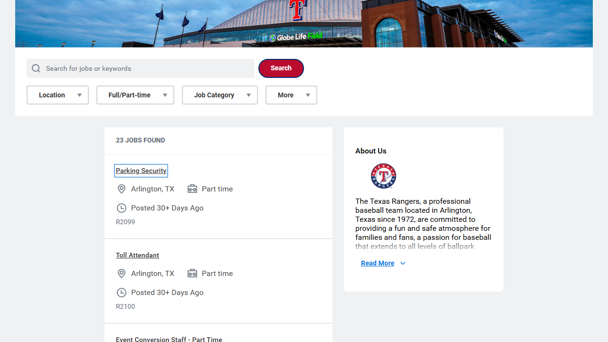
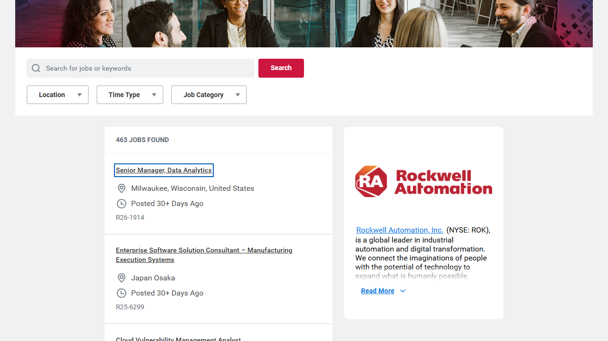
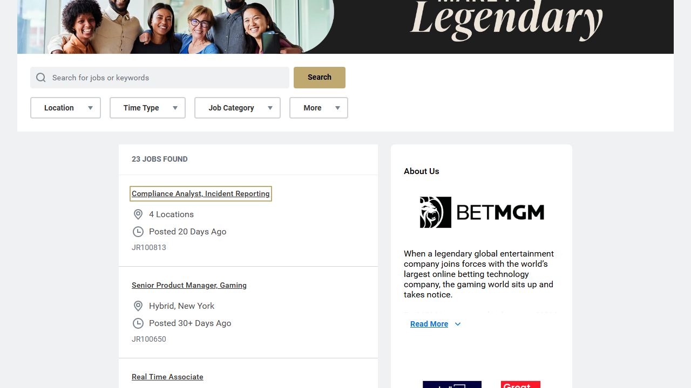

# November 18 cloud recovery for the ABET job scrapers

## Production verdict

Evidence was collected on November 17–18, 2026 UTC. The latest full runs collected jobs in all four modules. The production watchdog still reports a sportsbook detail warning. Each active-table figure below is a direct Supabase count taken after the sportsbook run ended at 05:14 UTC. The “jobs in run” column covers the latest completed full run. A database can retain active rows from an earlier observation pending confirmation of closure.

| Module | Full source result | Jobs in run | Active in database | Production receipt |
| --- | --- | ---: | ---: | --- |
| Sportsbook | 23 sources returned jobs, Chalkboard confirmed empty, 0 source errors, 0 timeouts | 849 published | 849 | [Full production receipt](20261118_cloud_recovery_evidence.json) · [New Kambi job in Discord](https://discord.com/channels/1306037905407479878/1478835376201269402/1572480368089632771) |
| Robotics | 66 of 66 succeeded | 16,858 collected, 16,776 distinct rows upserted | 17,844 | [Full recovery, 12 alerts and 611 confirmed retirements](https://github.com/misterplusev/job-radar/actions/runs/44232473031) |
| Sports teams | 152 of 152 sources succeeded, 124 of 124 official team links and route sets verified | 2,091 active, 6 new, 11 closed | 2,091 | [Production run](https://github.com/misterplusev/job-radar/actions/runs/44234946035) · [Team manifest artifact](https://github.com/misterplusev/job-radar/actions/runs/44234946035/artifacts/14396967532) |
| Tech | 13 of 13 succeeded | 3,727 upserted, 62 confirmed retirements, 45 alerts delivered | 3,727 | [Production run](https://github.com/misterplusev/job-radar-tech/actions/runs/44181677404) |

**Sportsbook descriptions.** The last production scrape published all 163 eligible Workday vacancies from BetMGM, Betway and Hard Rock. Their database rows held 162 descriptions. BetMGM held 23/23, Betway 28/28 and Hard Rock 111/112. FanDuel separately held 103/103. The run recorded 158 unsuccessful or deferred detail refreshes. Stored employer descriptions were retained when a fresh read was unavailable. The remaining missing descriptions were Hard Rock Bet — Data Scientist III. The ordinary sportsbook sender had 0 pending rows after delivery. Hard Rock’s independent corporate index confirmed Data Scientist III, R17674. Its 16 metadata fields include an apply link and location and omit the full job description.

**Hard Rock detail repair.** The employer vacancy URL serves a small JSON routing record if the HTTP client requests multiple representations. The repair requests the employer’s HTML representation and reads its JobPosting structured data. A 403, 429 or security challenge ends detail collection for that host. An independent PostgreSQL run fetched and stored all 112 actual descriptions. The production Space had fewer successful reads, so the most recent production counts above are the supportable result. `scripts/lib/workday_public_detail.py` and `scripts/providers/hardrock.py` were promoted from the accepted test. GitHub production was `43456f6c6c04797784d284350207c58f93adc86e` and Hugging Face production was `5903ee15d5df3eda0d5517452cbb166bbbb49cf5`. [Independent run](https://github.com/misterplusev/sportsbook-jobs-dashboard/actions/runs/44235109275) · [Exact promoted files](https://github.com/misterplusev/sportsbook-jobs-dashboard/commit/43456f6c6c04797784d284350207c58f93adc86e) · [Direct employer detail checks](https://github.com/misterplusev/job-radar/actions/runs/44232790542)

**Kambi and Chalkboard source correction.** The 04:15 UTC full Space run reported 22 sources with jobs and two empty. At 04:50 UTC the isolated sportsbook scheduler checked Kambi and caught a Greenhouse HTTP 404 that the old provider caught and returned as an empty list. Kambi’s corporate careers site links directly to Teamtailor. The revised provider joins the URLs on Kambi’s native career board to its employer-published RSS feed by job ID and rejects mismatches, malformed records and HTTP failures. All 4 live postings had descriptions, locations and employer dates in the isolated database and in production. [Retired endpoint in the scheduled receipt](https://github.com/misterplusev/sportsbook-jobs-dashboard/actions/runs/44240033263) · [Kambi corporate careers](https://www.kambi.com/working-at-kambi/open-positions/) · [Kambi’s native board](https://kambi.teamtailor.com/jobs)

Chalkboard’s own careers link identifies Ashby’s `chalkboard` tenant. The official public posting API returned HTTP 200, its API version, and an empty jobs array. The normal publisher now distinguishes an explicitly verified empty source from transport errors, malformed responses and unconfirmed empty lists. The latter cases retain all open rows. The verified zero retired 18 active records from the unrelated `chalk` tenant and 3 old genuine Chalkboard listings. The database retained all historical rows. Three matched Kambi openings were recognized across the ATS transition using a reviewed table of old and new URLs, job titles and city names. Their historical IDs remained available. One previously unseen Kambi role entered the normal queue and Discord returned its actual message and source URL. [Chalkboard’s official careers](https://jobs.ashbyhq.com/chalkboard) · [Isolated source, failure, database, replay and sender proof](https://github.com/misterplusev/sportsbook-jobs-dashboard/actions/runs/44242006690) · [Three individually reconciled openings](https://github.com/misterplusev/sportsbook-jobs-dashboard/actions/runs/44242317473) · [Actual Kambi alert](https://discord.com/channels/1306037905407479878/1478835376201269402/1572480368089632771)

The changed production files are `scripts/providers/kambi.py`, `scripts/providers/chalk.py`, `scripts/providers/base.py`, `scripts/provider_runner.py` and `scripts/scrape.py`. The five deployed Space files were compared byte-for-byte with the cloud-tested candidate. The rollback for this release is the same five paths at GitHub `43456f6c6c04797784d284350207c58f93adc86e` and Space `5903ee15d5df3eda0d5517452cbb166bbbb49cf5`. Closed legacy rows retain their IDs and the correction evidence identifies each previously active URL. Reopening individual rows requires current employer evidence. [Production code diff](https://github.com/misterplusev/sportsbook-jobs-dashboard/commit/06d3bb80fc2ea2254f8e90ac3ce35cc23d232fc4) · [Machine-readable counts and receipts](20261118_cloud_recovery_evidence.json)

**Team listings and enrichment.** A first retry attempted 250 detail records. Of those, 187 succeeded and 63 returned a denial or a cooldown. Eleven listing sources failed on that run when the runner could not retrieve the published GitHub asset and fell back to direct collection. The fix in `runtime/workday/preload_workday.py` uses the workflow’s read-only GitHub token and validates the asset’s SHA-256, size and capture time before exposing it as a runner-local temporary file. The actual workflow working directory and all 13 team Workday sources passed in isolation. The next full production run verified all 152 sources. I used `detail_limit=0` on that retry to avoid repeating the just-finished enrichment batch. Its manifest reported 181 pending detail records. [First production retry](https://github.com/misterplusev/job-radar/actions/runs/44233190274) · [Independent verification](https://github.com/misterplusev/job-radar/actions/runs/44234591736) · [Promoted workflow and loader](https://github.com/misterplusev/job-radar/commit/cf2dddff61f95df18f27e926c8bf24255ff68fb4)

**Watchdog and real deliveries.** The original failed scheduled robotics run and its later successful full run have separate GitHub IDs. The watchdog used to keep raising the original error even after recording the newer success. The scheduler now keeps the original slot’s failed receipt and records the later completed full run in `recovery`. It requires the same workflow on production master. A subsequent failure, queued attempt, or running attempt prevents a false clear. The scheduled 04:25 UTC check showed robotics recovered, database reachable and the sportsbook detail warning still open. Cloudflare’s deployed source matched the tested Git blob and retained its bindings. The approved `#system-health` webhook returned a message ID for a real incident and Discord returned the same message on readback. All four job channels also had real job messages checked against the corresponding database records. [Live health](https://abet-jobs-scheduler.abetscrape.workers.dev/health) · [Cloud tests](https://github.com/misterplusev/job-radar/actions/runs/44236682076) · [Production scheduler diff](https://github.com/misterplusev/job-radar/commit/ab387b28f1ace4e8875dd18b7b348d2e22c5d08d) · [Actual central incident](https://discord.com/channels/1306037905407479878/1446933103246442608/1572445000908677120)

**Workday refresh permission.** The single authorized cloud browser finished with zero owned browser processes remaining. Its official observation was taken at 02:37:47 UTC and the three-hour reader cutoff was 05:37:47 UTC on November 18 (9:37 p.m. Pacific November 17). At verification time the production repository did not have `WORKDAY_CLOUD_BROWSER_ENABLED=1`. Under the existing one-session exception, later runs use direct employer requests after that cutoff. Employers that rate-limit those requests can produce a partial run. The next scheduled teams slot is November 18 at 10:23 UTC, sportsbook at 11:00 UTC and robotics at 12:09 UTC. The capture and cleanup receipt prove this run. Further scheduled captures depend on recurring authorization. [Original report and all 19 screenshots](https://github.com/misterplusev/job-radar/actions/runs/44224552245/artifacts/14392705826)

**Independent boards and dashboard.** A GitHub-hosted HTTP check requested each standalone page, all four ABET dashboard routes and one active row from each module using the dashboard project’s published anonymous database role. Every page and data read returned HTTP 200. The evidence includes the job title and source URL for each sample. A visual browser render of the dashboard was outside the single employer-page browser test. [Cloud readback](https://github.com/misterplusev/job-radar/actions/runs/44237543907) · [Public data receipts](20261118_cloud_recovery_evidence.json)

| Module | ABET dashboard link |
| --- | --- |
| Sportsbook | [Sportsbook Jobs](https://abet-dashboard.vercel.app/?section=jobs&tab=jobs-browser) |
| Robotics | [Robotics Jobs](https://abet-dashboard.vercel.app/?section=jobs&tab=robotics-jobs) |
| Sports teams | [Sports Team Jobs](https://abet-dashboard.vercel.app/?section=jobs&tab=teams-jobs) |
| Tech | [Tech Jobs](https://abet-dashboard.vercel.app/?section=jobs&tab=tech-jobs) |

**Rollback for the final releases.** The scheduler recovery-only rollback is `runtime/cloudflare/worker.mjs` at `cf2dddff61f95df18f27e926c8bf24255ff68fb4`, preserving the acknowledged incident webhook and existing bindings. The preload-only rollback is the affected workflow and loader paths at the parent of `cf2dddff61f95df18f27e926c8bf24255ff68fb4`. For the Hard Rock HTML reader alone, restore the touched private repository paths at `d9332b42d5c7f92b3ecbab5b3fb008b6c45845f1` and the equivalent Hugging Face paths at `9b5087d6e5e24a60aef374d635b8505309f9623c`. Use an idle production window and compare the deployed file bytes with the selected revision. The rollback requires no table rewrite.

## Recurring independent development

The separate staging scheduler runs robotics, tech and teams hourly and sportsbook every four hours. The underlying staging probes rotate through a budgeted sample of employer sources. In addition to those probes, the full integration tests cited above exercised PostgreSQL persistence and Discord acknowledgements against an isolated receiver. Neither the staging controller nor its candidate subprocesses can write to the production jobs database or send real job alerts. The production scheduler still runs each module every twelve hours.

At the 04:39 UTC readback the staging controller’s configured candidate revisions matched the accepted production code for every module. Robotics and teams use `cf2dddff61f95df18f27e926c8bf24255ff68fb4`, tech uses `3d5c1e89ecded51fff43dcaca253d65e08b47f98` and sportsbook uses `43456f6c6c04797784d284350207c58f93adc86e`. The latest completed rotating runs at that readback had used the preceding revisions. The last direct Rockwell probe on that older revision received HTTP 429 and entered its existing cooldown. This is a separate measurement from the successful full production robotics run that read 463 Rockwell vacancies from the verified official snapshot. The value under `modules.<name>.source_sha` is the revision for new leases. `modules.<name>.latest.source_sha` identifies the revision that produced its displayed result.

The release updated `runtime/staging/worker.mjs` and `runtime/staging/runner/server.py`. An active lease retains its original revision through a deployment. The sportsbook regression run includes FanDuel’s catalog test. The staging Durable Object, credentials, budgets, rate-limit cooldowns and dispatch schedule were retained. To roll back this staging-only release, restore the affected files in its operating branch and its Worker from `571cfce0b124fac27ee4475f99bfe116074ae282`. Verify both downloaded Worker modules against the selected revision and inspect the next accepted lease’s source SHA. [Live development status](https://abet-jobs-staging.abetscrape.workers.dev/status) · [Isolated staging acceptance](https://github.com/misterplusev/job-radar/actions/runs/44238592805) · [Staging release](https://github.com/misterplusev/job-radar/commit/1c14e6311aa805d5be3bcd5c1a90533cbc7ed025)

The next ordinary four-hour sportsbook development slot at 2026-11-18T04:50:00.000Z ran the accepted commit. The configured workflow concluded failure. Its three regression suites reported 17 passed, 17 passed, 3 passed. The bounded source check reported kambi (failed, 0 listings, 1 HTTP requests). The run recorded zero production writes and zero Discord sends. [Scheduled development receipt](https://github.com/misterplusev/sportsbook-jobs-dashboard/actions/runs/44240033263)

After the 04:50 canary identified Kambi’s retired endpoint, the recurring staging catalog was changed to the two verified official hosts. Its exact guarded adapters read all four Kambi openings using two HTTP requests and verified Chalkboard’s empty board in one request. The approved source SHA for new sportsbook leases is now `06d3bb80fc2ea2254f8e90ac3ce35cc23d232fc4`. This separate targeted verification exercised the actual staging network guard and module code with zero production credentials. The real failed 04:50 lease remains in staging history. At 05:05 UTC the hourly robotics development run exercised direct HTTP against AutoStore and received HTTP 429. Its cooldown remains active. The production robotics run had read all 33 AutoStore listings from the approved official capture. [Guarded Kambi and Chalkboard readback](https://github.com/misterplusev/sportsbook-jobs-dashboard/actions/runs/44242556655) · [Current staging revision](https://github.com/misterplusev/job-radar/commit/a353dc335e60a9d5034fbdcdcaea06e32f1da649) · [AutoStore direct-source evidence](https://github.com/misterplusev/job-radar/actions/runs/44241717623)

## Official Workday pages checked

The counts below are the totals on each employer’s complete board during the cloud capture. The production sportsbook applies its existing role filter to the Hard Rock total.

| Module | Employer career page | Listed | Collected | Screenshot |
| --- | --- | ---: | ---: | --- |
| sports teams | [AMB Sports & Entertainment (AMBSE)](https://ambgroup.wd1.myworkdayjobs.com/en-US/AMBSE) | 18 | 18 | [View original](https://github.com/misterplusev/job-radar/blob/afe8f5a0b98c9a0972ed428728801afdd418b160/docs/job-scrapers/evidence/20261118-workday/00.png) |
| sports teams | [Atlanta Braves (AtlantaBraves)](https://atlantabravesmlb.wd5.myworkdayjobs.com/en-US/AtlantaBraves) | 3 | 3 | [View original](https://github.com/misterplusev/job-radar/blob/afe8f5a0b98c9a0972ed428728801afdd418b160/docs/job-scrapers/evidence/20261118-workday/01.png) |
| sports teams | [Chicago Cubs (Chicago_Cubs_FO)](https://my1060wd.wd5.myworkdayjobs.com/en-US/Chicago_Cubs_FO) | 3 | 3 | [View original](https://github.com/misterplusev/job-radar/blob/afe8f5a0b98c9a0972ed428728801afdd418b160/docs/job-scrapers/evidence/20261118-workday/02.png) |
| sports teams | [Seattle Mariners (Mariners)](https://mariners.wd5.myworkdayjobs.com/en-US/Mariners) | 3 | 3 | [View original](https://github.com/misterplusev/job-radar/blob/afe8f5a0b98c9a0972ed428728801afdd418b160/docs/job-scrapers/evidence/20261118-workday/03.png) |
| sports teams | [New York Mets (Mets)](https://sterlingmets.wd5.myworkdayjobs.com/en-US/Mets) | 23 | 23 | [View original](https://github.com/misterplusev/job-radar/blob/afe8f5a0b98c9a0972ed428728801afdd418b160/docs/job-scrapers/evidence/20261118-workday/04.png) |
| sports teams | [Texas Rangers (Rangers)](https://rangersmlb.wd5.myworkdayjobs.com/en-US/Rangers) | 23 | 23 | [View original](https://github.com/misterplusev/job-radar/blob/afe8f5a0b98c9a0972ed428728801afdd418b160/docs/job-scrapers/evidence/20261118-workday/05.png) |
| sports teams | [Chicago Cubs (Chicago_Cubs_Seasonal)](https://my1060wd.wd5.myworkdayjobs.com/en-US/Chicago_Cubs_Seasonal) | 0 | 0 | [View original](https://github.com/misterplusev/job-radar/blob/afe8f5a0b98c9a0972ed428728801afdd418b160/docs/job-scrapers/evidence/20261118-workday/06.png) |
| sports teams | [Marquee 360 (Marquee_360)](https://my1060wd.wd5.myworkdayjobs.com/en-US/Marquee_360) | 0 | 0 | [View original](https://github.com/misterplusev/job-radar/blob/afe8f5a0b98c9a0972ed428728801afdd418b160/docs/job-scrapers/evidence/20261118-workday/07.png) |
| sports teams | [Marquee Development (Marquee_Development)](https://my1060wd.wd5.myworkdayjobs.com/en-US/Marquee_Development) | 1 | 1 | [View original](https://github.com/misterplusev/job-radar/blob/afe8f5a0b98c9a0972ed428728801afdd418b160/docs/job-scrapers/evidence/20261118-workday/08.png) |
| sports teams | [Atlanta Hawks (External)](https://wd1.myworkdaysite.com/en-US/recruiting/hawks/External) | 13 | 13 | [View original](https://github.com/misterplusev/job-radar/blob/afe8f5a0b98c9a0972ed428728801afdd418b160/docs/job-scrapers/evidence/20261118-workday/09.png) |
| sports teams | [Maple Leaf Sports & Entertainment (MLSE)](https://mlse.wd3.myworkdayjobs.com/en-US/MLSE) | 69 | 69 | [View original](https://github.com/misterplusev/job-radar/blob/afe8f5a0b98c9a0972ed428728801afdd418b160/docs/job-scrapers/evidence/20261118-workday/10.png) |
| sports teams | [Detroit Tigers (Detroit-Tigers)](https://ilitch.wd5.myworkdayjobs.com/en-US/Detroit-Tigers) | 19 | 19 | [View original](https://github.com/misterplusev/job-radar/blob/afe8f5a0b98c9a0972ed428728801afdd418b160/docs/job-scrapers/evidence/20261118-workday/11.png) |
| sports teams | [Detroit Red Wings (Detroit-Red-Wings)](https://ilitch.wd5.myworkdayjobs.com/en-US/Detroit-Red-Wings) | 1 | 1 | [View original](https://github.com/misterplusev/job-radar/blob/afe8f5a0b98c9a0972ed428728801afdd418b160/docs/job-scrapers/evidence/20261118-workday/12.png) |
| robotics | [Boston Dynamics (Boston_Dynamics)](https://bostondynamics.wd1.myworkdayjobs.com/en-US/Boston_Dynamics) | 86 | 86 | [View original](https://github.com/misterplusev/job-radar/blob/afe8f5a0b98c9a0972ed428728801afdd418b160/docs/job-scrapers/evidence/20261118-workday/13.png) |
| robotics | [AutoStore (autostore)](https://autostore.wd3.myworkdayjobs.com/en-US/autostore) | 33 | 33 | [View original](https://github.com/misterplusev/job-radar/blob/afe8f5a0b98c9a0972ed428728801afdd418b160/docs/job-scrapers/evidence/20261118-workday/14.png) |
| robotics | [Rockwell Automation (External_Rockwell_Automation)](https://rockwellautomation.wd1.myworkdayjobs.com/en-US/External_Rockwell_Automation) | 463 | 463 | [View original](https://github.com/misterplusev/job-radar/blob/afe8f5a0b98c9a0972ed428728801afdd418b160/docs/job-scrapers/evidence/20261118-workday/15.png) |
| sportsbook | [BetMGM (BetMGM)](https://betmgminc.wd5.myworkdayjobs.com/en-US/BetMGM) | 23 | 23 | [View original](https://github.com/misterplusev/job-radar/blob/afe8f5a0b98c9a0972ed428728801afdd418b160/docs/job-scrapers/evidence/20261118-workday/16.png) |
| sportsbook | [Betway (Betway)](https://myhcm.wd3.myworkdayjobs.com/en-US/Betway) | 28 | 28 | [View original](https://github.com/misterplusev/job-radar/blob/afe8f5a0b98c9a0972ed428728801afdd418b160/docs/job-scrapers/evidence/20261118-workday/17.png) |
| sportsbook | [Hard Rock Bet (seminolehardrockcareers)](https://seminolehardrock.wd503.myworkdayjobs.com/en-US/seminolehardrockcareers) | 939 | 939 | [View original](https://github.com/misterplusev/job-radar/blob/afe8f5a0b98c9a0972ed428728801afdd418b160/docs/job-scrapers/evidence/20261118-workday/18.png) |

Preview the original Texas Rangers, Rockwell Automation and BetMGM career pages

**Texas Rangers**

**Rockwell Automation**

**BetMGM**

## Where to check

The [production scheduler](https://abet-jobs-scheduler.abetscrape.workers.dev/health) reports each scheduled slot, its last successful run, database reachability, the next alarm and the last central alert delivery. A successful full production retry has its own receipt. The scheduler keeps the original failed slot and records the newer recovery. A source-only test does not clear a failed full run. All timestamps below use UTC.

| Module | Production data | Actual Discord post |
| --- | --- | --- |
| Robotics | [Standalone board](https://misterplusev.github.io/robotics-jobradar-board/) · `robotics_jobs` | [Verified robotics message](https://discord.com/channels/1306037905407479878/1559253539337801860/1572458191588032595) |
| Tech | [Standalone board](https://misterplusev.github.io/jobradar-tech-board/) · `tech_jobs` | [Verified tech message](https://discord.com/channels/1306037905407479878/1559253461613150238/1572365373024637084) |
| Sports teams | [Standalone board](https://misterplusev.github.io/job-radar/) · `team_jobs` | [Verified team message](https://discord.com/channels/1306037905407479878/1569043665345708344/1572463384484380723) |
| Sportsbook | [Standalone board](https://sportsbook-jobs-dashboard.vercel.app/) · `jobs` | [Three new FanDuel jobs](https://discord.com/channels/1306037905407479878/1478835376201269402/1572446540755247228) |

The cloud receivers for the three public modules matched stored notification IDs and at least one job URL per message against Discord's own message bodies. The sportsbook readback matched all three new FanDuel links in a single message. [Robotics receipt](https://github.com/misterplusev/job-radar/actions/runs/44233120857) · [Team receipt after the full retry](https://github.com/misterplusev/job-radar/actions/runs/44235711894) · [Tech receipt](https://github.com/misterplusev/job-radar-tech/actions/runs/44233131028) · [Sportsbook sender](https://github.com/misterplusev/job-radar/actions/runs/44227358528)

## Changes and independent acceptance

| Component | Exact change and evidence |
| --- | --- |
| FanDuel | `scripts/providers/fanduel.py` joins the employer's career cards to its single Greenhouse feed by exact ID. It retains each employer-issued URL. Duplicate, mismatched or incomplete catalogs fail before writes. The old code made one request per detail and exhausted the source deadline. The tested two-request version saved 103 fully described jobs and acknowledged 103 in the isolated sender. Production had 100 matching historical URLs, three new ones and zero known ID aliases. [Development](https://github.com/misterplusev/sportsbook-jobs-dashboard/actions/runs/44225039900) · [Source diff](https://github.com/misterplusev/sportsbook-jobs-dashboard/commit/d457519d174e1b958d89c434bb7fe21aa1089d19) · [Production publication](https://github.com/misterplusev/sportsbook-jobs-dashboard/actions/runs/44227006435) |
| OpenAI | `jobradar/providers/ashby.py`, `jobradar/fetch_worker.py`, `jobradar/observations.py` and `run.py` keep usable records when an Ashby row is malformed. A missing title can use only an unambiguous historical title at the same company, exact URL, ATS and provider slug. An unresolved identity blocks retirements. The manifest records the URL and number of retained titles. Production processed 836 live URLs, 835 employer titles and one exact historical title. The targeted verification disabled retirements and generated zero new alert candidates. [Development](https://github.com/misterplusev/job-radar/actions/runs/44226338914) · [Source diff](https://github.com/misterplusev/job-radar/commit/f0aea7d33e83b4e3997ec3f09dc8ed4e0e8b39a0) · [Production recovery](https://github.com/misterplusev/job-radar/actions/runs/44227446771) |
| Workday sources | The authorized single cloud browser opened the 19 configured career pages and followed their public Next controls. Each native result carried the expected offset and a unique job path. Each final count equalled the employer's advertised total. The run recorded 1,748 jobs, 553 browser requests and zero owned browser processes after cleanup. Thirteen sources belong to teams, three to robotics and three to sportsbook. The capture includes the employer's unfiltered Hard Rock board. The sportsbook's corporate-role filter selected 112 of the 939 Hard Rock postings. [19-board tests and original screenshots](https://github.com/misterplusev/job-radar/actions/runs/44224552245) · [Accepted listing snapshot](https://github.com/misterplusev/job-radar/releases/tag/abet-workday-listings-v1) |
| Workday persistence | `jobradar/workday_snapshot.py`, `jobradar/providers/workday.py` and `sports_teams/live_refresh.py` consume the verified listing identities. In private sportsbook, `scripts/lib/workday_snapshot.py`, `scripts/lib/complete_listings.py`, `scripts/providers/betmgm.py` and `scripts/providers/betway.py` preserve complete listings when details are unavailable. Development saved 582 robotics jobs and 176 team jobs. It recognized two empty team boards and generated zero duplicate team rows on replay. Sportsbook saved and acknowledged 163 eligible jobs with zero repeat alerts against a simulated detail denial. [Public readers](https://github.com/misterplusev/job-radar/commit/9b4e80f8582ffff9ca963b3ee5251ab202596b35) · [Team and robotics proof](https://github.com/misterplusev/job-radar/actions/runs/44229996066) · [Sportsbook proof](https://github.com/misterplusev/sportsbook-jobs-dashboard/actions/runs/44231478562) |
| Team detail retries | `sports_teams/enrichment.py` handles the Hawks' native Workday tenant. An explicit 403 or 429 preserves prior descriptions and dates. It cools the affected organization or host for the remainder of the run, gives other employers a turn, records error counts by host and status, and delays subsequent attempts on the denied detail for 48 hours. Other errors are due after 12 hours and successful descriptions after seven days. [Source and tests](https://github.com/misterplusev/job-radar/commit/a5a0ea107bd3291025a4e879cd52abaab736ac9c) · [Cloud verification](https://github.com/misterplusev/job-radar/actions/runs/44231858860) |
| Central health alarm | The existing Cloudflare scheduler lacked its optional `ALERT_WEBHOOK` binding. The deployed scheduler now requests a Discord acknowledgement and records message and channel IDs under `last_alert_delivery`. Failed recovery notices retry on a later tick. The approved destination is `#system-health`. Discord returned the actual 02:55 UTC incident message on readback. [Isolated failure, deduplication and recovery fixtures](https://github.com/misterplusev/job-radar/actions/runs/44226194536) · [Source diff](https://github.com/misterplusev/job-radar/commit/d4d9b7b45440f7bfd8d6838e59d917f29e8a7140) · [Actual incident](https://discord.com/channels/1306037905407479878/1446933103246442608/1572445000908677120) |

## Snapshot operation and account costs

The production scheduler remains the only clock. In UTC it dispatches robotics at 00:09 and 12:09, tech at 09:37 and 21:37, teams at 10:23 and 22:23, and sportsbook at 11:00 and 23:00. GitHub Actions runs the public scrapers and the private Hugging Face Space runs sportsbook. The four databases listed above are tables in the existing Supabase project. The snapshot uses GitHub storage. It adds no Supabase table, no Cloudflare KV namespace and no new paid account.

`.github/workflows/workday-careers.yml` imports the one approved capture or runs the guarded collector when its explicit permission switch is enabled. Collection happens on one GitHub-hosted Windows runner. Its browser has no application database credential or Discord webhook. `runtime/workday/seal.py` checks the board inventory, identity counts and browser cleanup before releasing public job fields. `runtime/workday/publish_workday.py` writes the asset into the dedicated prerelease, reads its bytes back anonymously and retains the latest three managed assets. The first accepted file is 53,471 bytes with SHA-256 `f68c289ff9f545130b04650612468ca8735c5b78e44e7f3ddb3adc0b2d2f2ebc`. The readers reject data older than three hours and fall back to the existing direct provider. They do not use stale snapshots to infer closures. [Publisher acceptance](https://github.com/misterplusev/job-radar/actions/runs/44231554343) · [Bootstrap publication](https://github.com/misterplusev/job-radar/actions/runs/44232121949) · [Production workflows](https://github.com/misterplusev/job-radar/commit/8f355aad4f4e4dd4ae29fbefdcf509c629e34964)

The collection switch is the repository Actions variable `WORKDAY_CLOUD_BROWSER_ENABLED` in `misterplusev/job-radar`. An absent value or a value other than `1` skips new browser sessions. An explicit grant for recurring collection is required under the operator's machine stop rule. If enabled, the existing twice-daily teams invocation calls the collector first. A manually verified scrape with another trigger source does not start it. `WORKDAY_LISTINGS_ENABLED=1` is a separate reader setting. It permits reading an already published file and does not start a browser.

## Rollback

1. Stop future Workday browser launches by disabling `WORKDAY_CLOUD_BROWSER_ENABLED`. For an immediate reader rollback, set `WORKDAY_LISTINGS_ENABLED=0` for the affected production entry points and the sportsbook Space. Retain existing database rows, receipts and notification ledgers.
2. Revert just the affected paths identified by the source diffs. The public pre-Workday reader revision is `f0aea7d33e83b4e3997ec3f09dc8ed4e0e8b39a0`. The private sportsbook pre-Workday revision is `d457519d174e1b958d89c434bb7fe21aa1089d19` and its matching Space revision is `f3f609c59d8dc110033cd79fddf2d79fef745726`. Restore matching bytes in both places during an idle runtime. The pre-FanDuel revisions are GitHub `6fe2c160a375c7924cc2ee443183d55154fcd04f` and Space `fb55bbf3a66adc52356c056392be6e37ec517994`.
3. Roll back the alarm code independently if necessary. Restore only `runtime/cloudflare/worker.mjs` from `f7e5ef190cb75a14472da37e03c971846f4441d5`, preserve existing bindings and Durable Object storage, and compare the downloaded Worker hash with the restored Git blob. Removing the separate `ALERT_WEBHOOK` binding turns off the central incident notice. Existing module senders have their own bindings.
4. Check the next actual manifest, active database rows and real Discord receipts. A successful workflow or an available HTML page alone establishes only that one layer responded.
